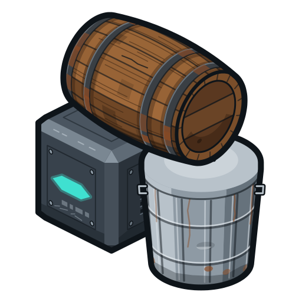

<p align="center"></p>

# Asset Manager

[](https://github.com/giollord/asset-manager/actions/workflows/build.yml)

A local, offline-first catalog for game assets on Windows: 3D models, animations, images, textures, sprite sheets, sounds, music, fonts, video and documents. It imports folders, archives (zip, 7z, rar, tar) and Unity packages, including containers nested inside one another, without unpacking them on disk. It renders previews, reads licenses and links from the files that come with a pack, and can describe and tag everything with a local AI model. Browsing, search and previews keep working when the external drives with the originals are detached.

The specification lives in [`openspec/specs`](openspec/specs), one folder per capability. The original proposal, design (decisions D1–D11) and task list are archived in [`openspec/changes/archive/2026-11-24-build-asset-manager`](openspec/changes/archive/2026-11-24-build-asset-manager); later changes are under [`openspec/changes`](openspec/changes).

## Download

Get `AssetManager-<version>-win-x64-portable.zip` from the [Releases](https://github.com/giollord/asset-manager/releases) page, extract it anywhere (a local folder, a USB stick, the external drive that holds your assets), and run `AssetManager.exe`. Nothing needs to be installed: the package includes .NET, the Windows App SDK, the AI runtime and FFmpeg; only the WebView2 runtime that ships with Windows 10 and 11 is used from the system. The app keeps all its data in the `data` folder next to it (see [Data folder](#data-folder)). The AI models are not included; download them in Settings → AI model.

## Building from source

### Requirements

- Windows 10 version 2004 (build 19041) or later, x64.
- .NET SDK 11.0.100 or a later 11.0 feature band (pinned in `global.json`; the projects target `net10.0`) with the MAUI workload: `dotnet workload install maui-windows`.
- Internet access for the first build only, which downloads the pinned FFmpeg and llama.cpp binaries (see [Bundled native binaries](#bundled-native-binaries)).
- Optional: a GPU with Vulkan support for the AI model. Without one, the CPU build is used.

### Build and run

```powershell
git clone <repository> asset-manager
cd asset-manager
dotnet build AssetManager/AssetManager.csproj
dotnet run --project AssetManager/AssetManager.csproj
```

The first build downloads FFmpeg and llama.cpp, verifies their SHA-256 hashes, and keeps them in the git-ignored folders `AssetManager.Processing/native/ffmpeg` and `AssetManager.AI/native/llama`. Later builds work offline.

On first start, the app creates its catalog in its data folder (see below). Settings → Catalog can open or create a catalog elsewhere.

#### Tests

```powershell
dotnet test --project AssetManager.Tests/AssetManager.Tests.csproj
```

Tests that need the real AI models or the sample asset library are skipped unless these environment variables are set:

| Variable | Value |
|---|---|
| `ASSETMANAGER_AI_MODEL` | path of `gemma-4-E4B-it-Q4_K_M.gguf` |
| `ASSETMANAGER_AI_MMPROJ` | path of `gemma-4-E4B-it-mmproj-F16.gguf` |
| `ASSETMANAGER_AI_EMBED` | path of `embeddinggemma-300M-Q8_0.gguf` |
| `ASSETMANAGER_SAMPLES` | a folder of real asset packs (e.g. `E:/Assets`) |

Test classes that start a real model server belong to the non-parallel `AiModelCollection`, since several multi-GB models loading at once on one GPU time out. Timing tests run alone in the `Performance` collection.

## Data folder

Everything the app creates lives in one data folder: the default catalog (`catalog.amdb`), `settings.json`, downloaded AI models (`models`), the extraction cache (`cache`), temporary files (`temp`), logs (`logs`) and the embedded browser profile (`webview`). Settings → About shows the folder in use, the mode and an "Open folder" button.

| Mode | When | Data folder |
|---|---|---|
| Portable | The app folder contains a file named `portable` (the portable package ships it) | `data` next to `AssetManager.exe` |
| Standard | No `portable` file, e.g. a build run from the repository | `%LOCALAPPDATA%\AssetManager` |
| Fallback | A portable copy whose folder cannot be written (e.g. under `Program Files`) | `%LOCALAPPDATA%\AssetManager`; Settings → About says why |
| Custom | The `ASSETMANAGER_DATA_DIR` environment variable is set (any build) | That folder, created if needed |

Paths in `settings.json` that point inside the data folder (the catalog and model files) are stored relative to it. A portable copy can therefore be moved to another folder, or its drive can get another letter, and it still finds its catalog and models. Paths outside the data folder are stored as given.

To use an existing catalog from a portable copy (for example the one in `%LOCALAPPDATA%\AssetManager` from a build run from source), either copy `catalog.amdb` and the `models` folder into the portable `data` folder before the first start, or open it with Settings → Catalog → "Open another catalog" and pick the model files in Settings → AI model.

## Continuous integration and releases

[`.github/workflows/build.yml`](.github/workflows/build.yml) runs on GitHub Actions (`windows-latest`):

- **Every push and pull request to `master`** (and manual runs from the Actions tab): run the test suite with the pinned SDK. A failing test fails the run. Nothing is packaged.
- **A version tag** runs the tests, then builds the portable package (with the MAUI workload), checks its contents (the app's `LICENSE.txt`, the AI runtime and FFmpeg with their licenses, no `.gguf` models) and that `AssetManager.exe` reports the tag's version, and publishes a GitHub Release with `AssetManager-<version>-win-x64-portable.zip`. Nothing is released if a test or the package check fails:

  ```powershell
  git tag v1.2.0
  git push origin v1.2.0
  ```

  The tag must look like `v<major>.<minor>.<patch>`; the app then reports that version in Settings → About and in its log.

The version always comes from the git tags, through [MinVer](https://github.com/adamralph/minver) (a build-time package in [`Directory.Build.props`](Directory.Build.props)): a build of the commit tagged `v1.2.0` is `1.2.0`, and a build five commits later is `1.2.1-alpha.0.5`. Both CI jobs check out the full history with tags; a clone without them builds as `0.0.0-alpha.0`.

The llama.cpp and FFmpeg downloads are cached between runs, keyed on the csproj files that pin them. The same publish runs locally, with the version of the checked-out commit:

```powershell
dotnet publish AssetManager/AssetManager.csproj -c Release -f net10.0-windows10.0.19041.0 -p:Portable=true -o publish/AssetManager
```

## AI models

The AI is optional. Without a model, imports still produce metadata and previews, and assets are marked "not enriched". The models run locally through the bundled `llama-server`. Nothing is sent to a remote service.

Settings → AI model offers a one-click download of the recommended models from Hugging Face into the `models` folder of the [data folder](#data-folder). Downloads resume after interruption and are verified against pinned SHA-256 hashes:

| Package | Files | Used for |
|---|---|---|
| Gemma 4 E4B (Q4_K_M) | [`gemma-4-E4B-it-Q4_K_M.gguf`](https://huggingface.co/unsloth/gemma-4-E4B-it-GGUF) (5.0 GB) and the vision projector `mmproj-F16.gguf` (1.0 GB) | descriptions, tags, licenses, links, orientation checks, collection descriptions |
| EmbeddingGemma 300M (Q8_0) | [`embeddinggemma-300M-Q8_0.gguf`](https://huggingface.co/ggml-org/embeddinggemma-300M-GGUF) (330 MB) | semantic search and "find similar" |

To use files you already have, pick them in Settings → AI model with "Pick file…". Any GGUF chat model that llama.cpp supports works; vision needs a matching `mmproj` file. Acceleration can be Auto (Vulkan GPU, else CPU), GPU or CPU.

## Architecture

The UI is Blazor with MudBlazor, hosted in a .NET MAUI `BlazorWebView` (WebView2). All logic is in plain .NET libraries, so the same UI also runs in a browser through the web dev host.

| Project | Contents |
|---|---|
| `AssetManager` | The MAUI Windows host: window, WebView2 setup (DevTools port, file drop), and the Windows platform services (clipboard file lists, folder and file pickers, open and reveal in Explorer, volume ids). |
| `AssetManager.Web` | Web dev host (Blazor Server) for fast UI iteration. Platform features (clipboard, pickers, Explorer) report "not supported" there. |
| `AssetManager.Shared` | The Razor UI: pages (Dashboard, Browse, Collections and tags, Sources, Import, Jobs, Settings), shared components (`AssetCard`, `AssetDetailsDrawer`, `BulkActionBar`, `ModelViewer`, `OriginalViewer`, `JobProgressView`) and the three.js preview renderer (`wwwroot/js/modelRenderer.js`). |
| `AssetManager.Core` | Domain entities, `Location` (volume id + path + entries inside nested containers), search queries, job and platform abstractions, app settings. |
| `AssetManager.Data` | The catalog: EF Core on SQLite with FTS5 full-text search, sqlite-vec vector search (with an in-memory fallback), migrations, the persistent job queue, statistics, and tag, collection, source, edit and deletion services. |
| `AssetManager.Processing` | Container readers (zip, 7z, rar, tar, gzip, `.unitypackage`), the virtual file system and extraction cache, location resolution, file classification and grouping, type handlers (image, model, audio, video, font, document), previews, the import staging pipeline, re-import, stored originals and export. |
| `AssetManager.AI` | The `llama-server` host and model downloads, structured prompts (pack pass, item pass, orientation judgment, collection descriptions), embeddings, semantic search, and the AI queue. |
| `AssetManager.Tests` | xUnit v3 and bUnit tests, with generated fixtures (zip, 7z, tar, Unity packages, FBX/OBJ scenes). |

The logo masters are in `branding/`: `logo.svg` (the full group) and `logo-mark.svg` (the crate alone, used for favicons and the app bar). The app icon, splash, loading screen and favicon SVGs are copies of them, and `BrandingTests` fails when a copy drifts from its master.

Main ideas (details in `design.md`):

- **One catalog file.** Metadata, previews, settings, jobs and optional stored copies of originals live in one SQLite file. Originals stay where they are and are found by volume serial and relative path, so a drive that gets a new letter is still found.
- **Nested containers are virtual.** A zip inside a folder inside a Unity package is walked without unpacking it on disk. Single entries are extracted on demand into a size- and age-limited cache.
- **Staged imports.** An import scans, groups files into assets (a model with its textures, a sprite sheet), renders previews and runs the AI into staging rows. The user reviews and edits, then confirms; nothing enters the catalog before that. A new version of a cataloged package is detected and replaces the old one in place, keeping user edits.
- **Previews.** Images become WebP thumbnails. Models are rendered offscreen by three.js in the WebView from a GLB written by our own `GlbWriter` (Assimp loads the files): 24 views around the model. Animations become a looping animated WebP. Audio gets a short Opus clip and a waveform. Every size and threshold is a setting stored in the catalog.
- **Jobs.** Every long operation (import, re-import, previews, AI, store/unstore, export, compaction) is a persistent job with stages, progress, ETA, per-item errors, "Retry failed", and resume after a restart.

### Debugging the app

Debug builds of the MAUI app expose WebView2 DevTools on `127.0.0.1:9333` (`ASSETMANAGER_CDP_PORT` changes it; `0` disables it). `node tools/cdp.mjs` drives the running app from a terminal: `eval`, `text`, `click`, `type`, `nav`, `wait`, `shot`, `console`. The .NET log is written to `logs\app-YYYYMMDD.log` in the [data folder](#data-folder) (`%LOCALAPPDATA%\AssetManager` for a build run from the repository).

### Web dev host

```powershell
dotnet run --project AssetManager.Web
```

It serves the same UI at `http://localhost:5022` and uses the same catalog and settings under `%LOCALAPPDATA%\AssetManager`. Run it or the MAUI app, not both at once, since both use the same catalog file.

## Bundled native binaries

| Component | Version | License | How it is included |
|---|---|---|---|
| [FFmpeg](https://ffmpeg.org) (LGPL shared build from [BtbN/FFmpeg-Builds](https://github.com/BtbN/FFmpeg-Builds)) | 8.1 | LGPL 2.1+ | Downloaded at build time, SHA-256 pinned in `AssetManager.Processing.csproj`, copied to `ffmpeg/` beside the app with its `FFMPEG.LICENSE.txt`. The DLLs are loaded dynamically, unmodified, by the separate `ffmpeg.exe`/`ffprobe.exe` processes. |
| [llama.cpp](https://github.com/ggml-org/llama.cpp) `llama-server` (Vulkan and CPU builds) | b12141 | MIT | Downloaded at build time, SHA-256 pinned in `AssetManager.AI.csproj`, copied to `llama/vulkan` and `llama/cpu`. Its MIT license (from the same tag; the release zips do not include it) is checked in under `AssetManager.AI/licenses` and copied to `llama/LICENSE.txt`. |
| [Assimp](https://github.com/assimp/assimp) through the AssimpNetter NuGet package | 6.x | BSD 3-Clause | NuGet package with the native library. |
| [ImageMagick](https://imagemagick.org) through Magick.NET | Q8 x64 | ImageMagick License (Apache 2.0 style) | NuGet package with the native library. |
| [sqlite-vec](https://github.com/asg017/sqlite-vec) `vec0.dll` | 0.1.9 | MIT | Checked in under `AssetManager.Data/native/win-x64` with its license. |
| [three.js](https://threejs.org) | r186 | MIT | Vendored ES modules under `AssetManager.Shared/wwwroot/lib/three` (see `VERSION.txt`). |
| [Roboto](https://github.com/googlefonts/roboto-classic) font | — | SIL Open Font License 1.1 | Bundled under `AssetManager.Shared/wwwroot/lib/roboto`, so the UI needs no internet. |

The AI models are not bundled. They are downloaded on request, and their licenses (the Gemma terms of use) apply to them.

## License

Asset Manager is released under the [MIT License](LICENSE). The portable package includes it as `LICENSE.txt` next to `AssetManager.exe`. Third-party components keep their own licenses; see [Bundled native binaries](#bundled-native-binaries).
